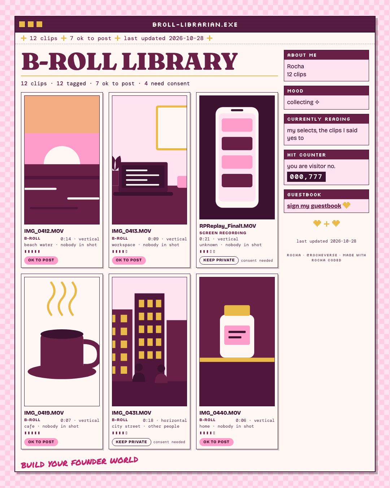
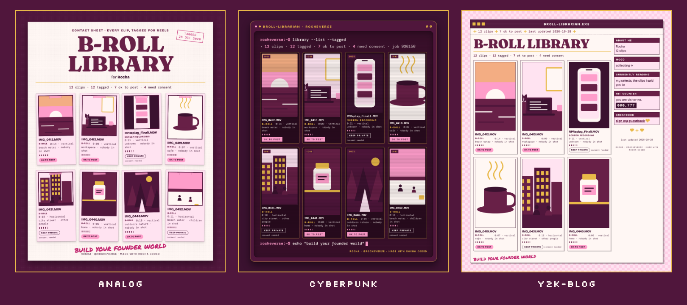

# B-roll Librarian

*Rocha Coded. Free tools from the Rocheverse.*

**Point Claude at your camera roll. Every clip gets tagged for reels.**

You filmed it all. Now you can find it.
Point Claude at a folder of clips and it tags every one: what it is, where it was filmed, who is in shot and the mood.
You get a library you can browse, and a list of the clips that are safe to post.
Anything with another person, a child or a screen stays private until you say otherwise.

<p align="center"></p>

<p align="center"></p>

<p align="center"><sub>One library, three moods: analog, cyberpunk, y2k-blog. Twelve made-up clips with drawn stand-in pictures. There are no photos of real people anywhere in this tool.</sub></p>

## Start here
You can do this. Each step tells you what to type and what you will see when it worked.

**If you use Claude Code** (Claude in the terminal, the window where you type commands to your computer):

 Open the Terminal app. On a Mac it is in Applications > Utilities > Terminal.
   This checks that Python, the language the tool is written in, and ffmpeg, a free program that reads video files, are ready:
   ```sh
   python3 --version && ffmpeg -version
   ```
   You will see `Python 3.10` or a higher number, then a line starting `ffmpeg version`.
   If it says `ffmpeg: command not found`, type `brew install ffmpeg` on a Mac (or `winget install ffmpeg` on Windows), wait for it to finish, and try again.

 This copies the tool onto your computer. "Clone" means download a copy from GitHub, the site where the code lives:
   ```sh
   git clone https://github.com/RochaStone/broll-librarian ~/.claude/skills/broll-librarian
   ```
   You will see `Cloning into...` and then the line where you type comes back.

 This makes a folder for your library and opens Claude Code inside it:
   ```sh
   mkdir -p ~/broll && cd ~/broll && claude
   ```
   You will see Claude Code open and wait for you.

 Type this to Claude, in your own words if you like:
   ```
   Tag my camera roll for reels.
   ```
   You will see Claude explain what it will do and ask if that is okay. Then it asks which folder holds your clips. It asks one thing at a time, and it starts with ten clips so you can see how it looks.

 When Claude says your library is ready, this opens it in your browser:
   ```sh
   open library/library.html
   ```
   You will see a card for every clip, with filters across the top.

**If you use Claude Cowork** (the Claude desktop app): download the zip (one file that holds the whole tool),
upload it in Customize > Skills, give a task your clips folder, and say "Tag my camera roll for reels."
Cowork may not have ffmpeg, so read [Claude Cowork](#claude-cowork) below first.

<p align="center"></p>

## What you get
- **A library page.** `library.html` opens in any browser. A card for every clip, with a picture from it, its kind, place, mood, quality and a pill that says ok to post or keep private. Filter by what you can post, by kind and by place, or search.
- **A tag on every clip.** Each clip gets: b-roll, talking head or screen recording; whether a product is in shot; the place; who is in it; one to three moods; how the camera moves; where it could sit in a reel; and a quality score.
- **A privacy gate.** Every clip starts as private. More on that in the next section.
- **A selects list.** `selects.md` lists only the clips that are ok to post, best first, ready for the for-reels kit.
- **A catalog.** `catalog.json` holds everything, if you want to build on it.
- **A check for cheaper models.** If you tag hundreds of clips, a scorer shows whether a cheaper model tags as well as your best one before you trust it.

Your clips are only read. Nothing is moved, changed or deleted.

<p align="center"></p>

## The privacy gate
Your camera roll is personal, so every clip begins as private.
- **Usable starts at no.** Claude can mark a clip yes only when the pictures show nothing that needs a second look.
- **Other people, children and screens stay private.** If anyone else is in shot, even in the background, if any child is, or if a phone or computer screen is, the clip is kept private whatever else is tagged. This is the gate, and it is not negotiable by the tagger.
- **Only you widen it.** You can say no to any clip, any time. To say yes to a clip with other people in it, you add a note in your own words about who agreed and how. Without the note it stays private.
- **Unsure means no.** A wrong no costs you a second look. A wrong yes could put someone in public who did not agree.

### A note on consent
If someone else is in a clip, if a child is, or if a screen shows someone else's messages or details, ask before you post it.
The tool cannot know who agreed. It only keeps those clips private until you tell it. Look at a clip once before it goes public, even when it says ok to post.

### What leaves your computer
The tool itself uploads nothing and makes no account. Claude looks at the key frames, which are a few still pictures from each clip, in your session, the same as any file you share with it. Your clips themselves are never opened by Claude. The `library` folder stays on your computer.
Keep `library.html` and the `library` folder to yourself, because they show your real pictures.

<p align="center"></p>

## Install
It runs inside Claude. Nothing to host, no account to make.

| Where you use it | Install it | Start it |
|---|---|---|
| [Claude Code](#claude-code) (recommended) | clone into `~/.claude/skills` | say "tag my camera roll for reels" |
| [Claude Cowork](#claude-cowork) | upload `broll-librarian.zip` as a skill | ask in a Cowork task |

You need Python 3.10 or newer and ffmpeg. For the library picture you also need Google Chrome or Chromium installed.
Without Chrome you still get the library page.

### Claude Code
```sh
git clone https://github.com/RochaStone/broll-librarian ~/.claude/skills/broll-librarian
```
Open Claude Code in a folder where you want your library saved, and say: "Tag my camera roll for reels."
To update later: `git -C ~/.claude/skills/broll-librarian pull`.

### Claude Cowork
Cowork (the Claude desktop app) runs tasks in a sandbox on your computer that can only reach the folders you give it.
1. Download `broll-librarian.zip` from the [latest release](https://github.com/RochaStone/broll-librarian/releases/latest).
2. In the Claude desktop app: Customize > Skills, then + > Create skill > Upload a skill, and pick the zip.
3. In Settings > Capabilities, turn on code execution and file creation.
4. Make a folder for your library, for example `broll` in your home folder, and put (or export) the clips you want tagged somewhere Cowork can reach. Start a Cowork task, give it access to both folders, and say: "Tag my camera roll for reels."

Reading clips needs ffmpeg, and the Cowork sandbox may not have it. If it does not, Claude will tell you plainly, and Claude Code is the way to go. The library, selects and scorer parts need nothing extra.

<p align="center"></p>

## How it works
Five small steps. Claude runs them for you and tells you what it is doing.

| Step | What happens | File it makes |
|---|---|---|
| 1. Ingest | reads each clip and pulls key frames where the scene changes (a calm clip gets three even frames) | `library/frames/`, `worklist.json`, `batches/` |
| 2. Tag | Claude looks at the key frames and writes one tag line per clip, using the prompt in `prompts/tag-clips.md` | `library/tags/*.jsonl` |
| 3. Catalog | the tags are checked, the privacy gate is applied, your own decisions are added | `library/catalog.json` |
| 4. Library | the browsable page, in your motif | `library/library.html` |
| 5. Selects | the clips that are ok to post, best first | `library/selects.md` |

To say no to a clip, or yes with consent, Claude writes a line in `library/overrides.json`:
```json
{
  "sunrise-swim-3f9a1c": { "usable": "no" },
  "market-walk-e4417b": { "usable": "yes", "consent": "everyone in it said yes by message" }
}
```
For the curious, run any step by hand:
```sh
python3 ingest.py ~/Movies/clips --library library --limit 10
python3 catalog.py --library library
python3 library_render.py --library library --motif cyberpunk
python3 selects.py --library library --mood calm --limit 12
```

### Words you might meet
- **Terminal:** the window where you type commands to your computer.
- **ffmpeg:** a free program that reads video files. The tool uses it to pull still pictures from your clips.
- **Key frame:** a still picture pulled from a clip where the scene changes.
- **B-roll:** footage of things, places and moments, where nobody is talking to the camera.
- **A-roll:** you, talking to the camera. The tool keeps it apart as "talking head".
- **Tag:** a short label on a clip, like place or mood.
- **Catalog:** the list of every clip and its tags.
- **Zip:** one file that holds a whole folder.
- **Clone:** download a copy of the tool from GitHub.

## Check a cheaper model
Tagging a big camera roll costs less with a cheaper model, but only if it tags as well as your best one.
Your best model's tags are the answer key (the director). A cheaper model tags the same twenty clips blind. The scorer compares them field by field:
```sh
python3 scorer.py --truth tests/fixtures/director.jsonl tests/fixtures/crew-small.jsonl tests/fixtures/crew-mid.jsonl
```
That runs on a made-up example. You will see `crew-small: FAIL`, `crew-mid: PASS` and `Use for the fleet: crew-mid`.
List your models cheapest first and it recommends the cheapest one that passes. The bar is in `taxonomy.json` under `eval_gate`.
Mood and reel role are taste, so they never decide a pass. The privacy field is held strictest: if a model says ok to post where your best model said private, even once, it fails.

## If it goes wrong (everyone's first time) 
This happens to everyone the first time. Here are the three most common moments and the fix for each.
- **The terminal says `ffmpeg: command not found`.** The tool needs ffmpeg to read your clips. On a Mac with Homebrew, type `brew install ffmpeg`. On Windows, type `winget install ffmpeg`. Close the terminal, open it again, and run the step again.
- **It says `No video clips found`.** Check the folder path, and check the clips are in that folder and not inside the Photos app. In Photos, select your clips, choose File > Export > Export Unmodified Original, and save them into a new folder. Then point Claude at that folder.
- **The library page shows no pictures.** The page finds its pictures by their place inside the `library` folder, so keep `library.html` there. If you moved it, move it back, or ask Claude to make the page again.

<p align="center"></p>

## Make it yours
Your look lives in one file, `style.json`: your colours, fonts, your own scrawl line, and your name and handle on the library page.
It ships with two examples: `examples/style.rocha-coded.json` (my plum and pink) and a blank `style.example.json` for yours, explained in `STYLE.md`. Or ask Claude to make one with you from a few references.
Pick your motif, `analog`, `cyberpunk` or `y2k-blog`, to change the structure. Your palette and fonts re-tone all three, so every version is yours to curate.
The same file works across every Rocha Coded tool, so you make it once.

## What's inside
| File | What it does |
|---|---|
| `SKILL.md` | the steps Claude follows: the privacy talk, the folder, the frames, the tags, the library |
| `ingest.py` | reads a folder of clips, pulls key frames with ffmpeg, writes the tagging batches |
| `frames.py` | finds clips, builds the ffprobe and ffmpeg commands, and runs them |
| `taxonomy.json`, `taxonomy.py` | every field and value a clip can have, the checker, and the privacy gate |
| `prompts/tag-clips.md` | the tagging prompt: give it to Claude, or to many helpers at once |
| `catalog.py` | merges details, tags and your decisions into `catalog.json` |
| `library_render.py` | draws the library page in all three motifs from one function, and makes the picture |
| `selects.py` | writes `selects.md` for the for-reels kit |
| `scorer.py` | checks a cheaper model against your best one, field by field |
| `style.py`, `assets/` | your style file loader, and the three looks as stylesheets |
| `examples/` | Rocha's example style, and a made-up sample library with its catalog, page and selects |
| `scripts/make-readme-images.py` | makes every image in this README from the tool itself, listed in `docs/IMAGES.md` |
| `tests/` | the tests, the made-up scoring fixture, and `tests/TESTING.md` with exactly what was run |
| `style.example.json`, `STYLE.md` | your look in one file, and what each key does |

Everything is plain Python from the standard library, and ffmpeg for reading clips. No packages to install.
The library page loads its fonts from Google Fonts and falls back to fonts already on your computer when you are offline.

## Licence
MIT. See [LICENSE](LICENSE). Copyright (c) 2026 Rochelle Livingstone / Thriving Era Studio.

 [Sign my guestbook](https://github.com/RochaStone/broll-librarian/issues)

## Made by Rocha

Rocha \
Brand Alchemist & AI Architect \
Author of *Brand Alchemy in the Thriving Era* and *Thriving in Transformational Times* \
Creator of [Conscious Founder Operating System](https://founders.thrivingera.com) \
Founder, [Thriving Era Studio](https://thrivingera.com)

I help female founders build their founder world, and I build what they need next. \
Start with the audit: [thrivingera.com/audit](https://thrivingera.com/audit). \
Or book an exploratory call: [calendly.com/rochelle-thrivingera/exploratory-call](https://calendly.com/rochelle-thrivingera/exploratory-call). It is where we decide if we work together.

[Instagram @rocheverse](https://instagram.com/rocheverse) · [Substack](https://rochastone.substack.com) · [LinkedIn](https://www.linkedin.com/in/rochellelivingstonecosmic) · [More free tools](https://thrivingera.com/free) · [All tools on GitHub](https://github.com/RochaStone)
